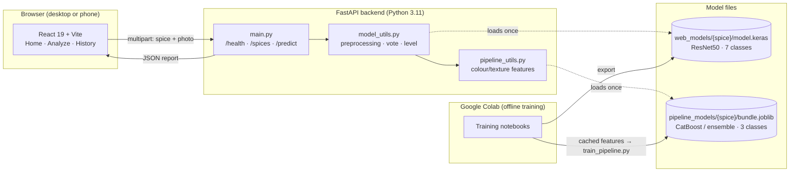
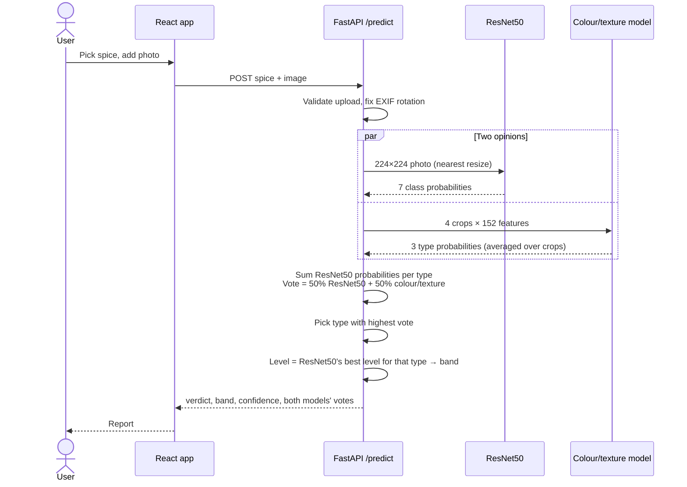
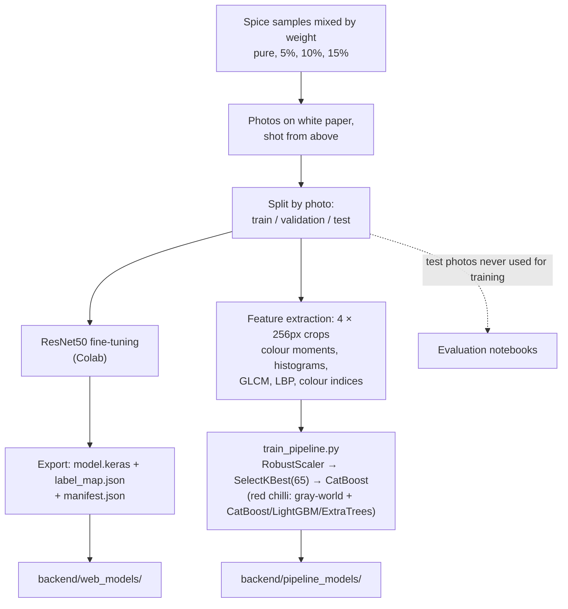

# Food-Sure

**Image-based screening for adulterated spice powders.**

Food-Sure looks at a photo of black pepper, red chilli or turmeric powder and reports whether it has been mixed with a cheaper filler, which filler, and roughly how much. Two models vote on every photo: a fine-tuned **ResNet50** and a **colour/texture** model built on handcrafted features.

> [!IMPORTANT]
> Food-Sure is a screening aid built for study. It does not replace a laboratory test.

Final Year Project, BSCS 2026, Bahria University Karachi. Supervised by Dr. Asia Samreen.
Team: Ovais Bin Amer, Nimra Rashid, Mahnoor Shah.

---

## Contents

- [What it detects](#what-it-detects)
- [Results](#results)
- [System architecture](#system-architecture)
- [How a prediction is made](#how-a-prediction-is-made)
- [Training pipeline](#training-pipeline)
- [Repository layout](#repository-layout)
- [Getting started](#getting-started)
- [API](#api)
- [Testing](#testing)
- [Limitations](#limitations)
- [Future goals](#future-goals)

---

## What it detects

| Spice | Fillers | Levels it was trained on |
|---|---|---|
| Black pepper powder | charcoal, millet | 5%, 10%, 15% |
| Red chilli powder | sawdust, semolina | 5%, 10%, 15% |
| Turmeric powder | rice flour, semolina | 5%, 10%, 15% |

Each spice is a 7-class problem: pure, plus 2 fillers × 3 levels. Because the samples were mixed at exactly 5, 10 and 15% by weight, the level is reported as a band:

| Band | Range |
|---|---|
| Low | under 7.5% |
| Medium | 7.5–12.5% |
| High | above 12.5% |

## Results

These results come from held-out test photos that were never used for training (`Food_Sure_Vote_Test.ipynb`).

| Spice | Test photos | Right filler (or pure) | Right filler **and** level |
|---|---|---|---|
| Black pepper | 56 | **96.4%** (54) | 87.5% (49) |
| Red chilli | 56 | **80.4%** (45) | 60.7% (34) |
| Turmeric | 57 | **96.5%** (55) | 82.5% (47) |

For comparison, ResNet50 on its own scores 82.1% / 62.5% / 79.0% on the full 7-class task.

> [!NOTE]
> The test sets are small, about 8 photos per class, so one photo moves a score by about 1.8 points. Treat the numbers as indicative.

---

## System architecture



| Layer | Technology |
|---|---|
| Frontend | React 19, Vite 8, Tailwind CSS 4, React Router 7 |
| API | FastAPI 0.115, Uvicorn |
| Deep model | TensorFlow 2.17 / Keras, ResNet50 (ImageNet weights, fine-tuned) |
| Colour/texture model | OpenCV, scikit-image (GLCM, LBP), scikit-learn, CatBoost, LightGBM |
| Training | Google Colab, Google Drive |
| Large files | Git LFS (`*.keras`) |

Each model is loaded on the first request for its spice and then kept in memory. The history list exists only in the browser and is lost when the page reloads.

## How a prediction is made



1. **Which filler (vote).** ResNet50's 7 probabilities are added up into 3 types (pure, filler A, filler B) and averaged 50/50 with the colour/texture model's 3 probabilities. The 50/50 weight was fixed in advance, not tuned on the test photos.
2. **How much.** For the chosen filler, ResNet50's most likely level becomes the band.
3. **Fallback.** If the colour/texture model is missing for a spice, the API answers with ResNet50 alone and says so in `decision`.

## Training pipeline



---

## Repository layout

```text
.
├── backend/
│   ├── main.py               FastAPI app and routes
│   ├── model_utils.py        ResNet50 inference, vote and level logic
│   ├── pipeline_utils.py     colour/texture feature extractor and classifier
│   ├── train_pipeline.py     builds pipeline_models/ from cached features
│   ├── test_predict.py       regression test on the sample photos
│   ├── requirements.txt
│   ├── features/             cached feature files (.npz) from Colab
│   ├── pipeline_models/      colour/texture models per spice
│   └── web_models/           ResNet50 models per spice (Git LFS)
├── foodsure-web/             React + Vite frontend
│   ├── src/pages/            Home, Analyze, History
│   ├── src/components/       NavBar, Dropzone, ResultPanel, Footer
│   └── public/samples/       sample photos and thumbnails
├── sample_test_photos/       real photos per spice and mix
├── *.ipynb                   training and evaluation notebooks
└── cell13_export_models.py   Colab cell that exports the web models
```

## Getting started

### Prerequisites

- Python **3.11**
- Node.js 20 or newer
- [Git LFS](https://git-lfs.com), needed for the ResNet50 models (about 640 MB)

### 1. Clone with the models

```bash
git clone https://github.com/ovaisbinamer/food_sure.git
cd food_sure
git lfs pull
```

### 2. Backend

```bash
cd backend
py -3.11 -m pip install -r requirements.txt
py -3.11 -m uvicorn main:app --host 0.0.0.0 --port 8000
```

Interactive API docs: <http://127.0.0.1:8000/docs>

> [!WARNING]
> Keep `numpy` on 1.26.x. TensorFlow 2.17 breaks with numpy 2, and installing extra packages without the pins in `requirements.txt` can upgrade it silently.

### 3. Frontend

```bash
cd foodsure-web
npm install
npm run dev
```

Open <http://127.0.0.1:5173>. To use it from a phone on the same Wi-Fi, open the `Network:` address that Vite prints. Windows Firewall must allow inbound TCP 8000.

| Variable | Where | Default | Purpose |
|---|---|---|---|
| `VITE_API_BASE` | frontend `.env` | `http://<page host>:8000` | Backend URL |
| `WEB_MODELS_DIR` | backend | `backend/web_models` | ResNet50 model folder |
| `PIPELINE_MODELS_DIR` | backend | `backend/pipeline_models` | Colour/texture model folder |
| `VOTE_WEIGHT_RESNET` | backend | `0.5` | ResNet50's share of the vote |
| `LOW_CONFIDENCE_THRESHOLD` | backend | `0.45` | Below this, the report warns that the photo may be unclear |

---

## API

| Method | Path | Description |
|---|---|---|
| `GET` | `/health` | Liveness check |
| `GET` | `/spices` | Spices the backend has models for |
| `POST` | `/predict` | Form fields `spice` and `file` (image). Returns the report |

```bash
curl -X POST http://127.0.0.1:8000/predict \
  -F "spice=turmeric" \
  -F "file=@foodsure-web/public/samples/turmeric__10_pct_rice_flour.jpg"
```

<details>
<summary>Example response</summary>

```json
{
  "spice": "turmeric",
  "predicted_class": "10_pct_rice_flour",
  "confidence": 0.9317,
  "adulterant": "rice_flour",
  "severity": "MEDIUM",
  "concentration_pct": 10,
  "concentration_range": "7.5-12.5%",
  "level_confidence": 0.6121,
  "severity_message": "Moderate adulteration detected (rice flour, 7.5-12.5%).",
  "model_used": "ResNet50 + colour/texture pipeline",
  "decision": "vote",
  "models_agree": true,
  "type_votes": [
    { "type": "rice_flour", "voted": 0.9317, "resnet50": 0.9883, "pipeline": 0.8751 },
    { "type": "pure",       "voted": 0.0494, "resnet50": 0.0106, "pipeline": 0.0882 },
    { "type": "semolina",   "voted": 0.0189, "resnet50": 0.0011, "pipeline": 0.0367 }
  ],
  "top3": [["10_pct_rice_flour", 0.6049], ["15_pct_rice_flour", 0.241], ["5_pct_rice_flour", 0.1424]],
  "low_confidence": false,
  "warning": null
}
```

This is the real response for that photo.

</details>

Errors: `400` for a bad upload or an unknown spice, and `503` when model files are missing.

## Testing

```bash
cd backend
py -3.11 test_predict.py
```

This test pins the current answers on the six sample photos, so any change to preprocessing, resizing or voting that shifts a result makes it fail. It also checks that bad uploads are rejected with `400`. After retraining, check the new answers and update `EXPECTED` in the test.

---

## Limitations

- **It only knows three spices and six fillers.** Any other filler is reported as one of these, or as pure.
- **It can't tell when the wrong spice was picked.** Each spice has its own models and will still give a confident answer. The report reminds the user of this.
- **It can't detect dyes or chemicals.** Artificial colours and lead chromate are invisible to a photo model.
- **It is sensitive to the photo setup.** It was trained on powder on white paper, shot from above. Other lighting or backgrounds can change the answer.
- **The test sets are small.** About 56 photos per spice.

---

## Future goals

```mermaid
flowchart LR
    subgraph N["Next"]
        direction TB
        N1["Wrong-spice check<br/>(CLIP gate: 21/24 caught<br/>in a 12-photo trial)"]
        N2["Validate on market samples<br/>with external lab results"]
        N3["Larger, more varied dataset<br/>lighting · phones · backgrounds"]
    end
    subgraph L["Later"]
        direction TB
        L1["Smaller models<br/>TFLite / quantisation<br/>(640 MB → tens of MB)"]
        L2["Cloud deployment<br/>hosted API + web app"]
        L3["Saved history and<br/>printable reports"]
    end
    subgraph V["Vision"]
        direction TB
        V1["On-device mobile app<br/>works offline"]
        V2["More spices and fillers<br/>chilli, coriander, cumin…"]
        V3["Pair with low-cost<br/>spectroscopy for dyes"]
    end
    N --> L --> V
```



| Goal | Why it matters |
|---|---|
| **Wrong-spice check** | The biggest current gap. A zero-shot CLIP check caught 21 of 24 wrong-spice photos with no false alarms in a small trial. It still needs validation on the full test set and its own runtime environment. |
| **Market-sample validation** | Every current result uses samples we mixed ourselves. Retail samples with external lab results would show real-world accuracy. |
| **Larger dataset** | More photos per class would tighten the accuracy estimates and help with lighting and phone variation. Red chilli needs this most. |
| **Model compression** | Three 214 MB ResNet50 files make hosting and mobile use expensive. Converting to TFLite with quantisation could cut that by about 10×. |
| **Deployment** | A hosted API and web app with HTTPS, CORS locked to the app's own domain, and upload limits. |
| **Mobile app** | Runs on the phone, uses the camera directly, and keeps working without internet. |
| **Wider coverage** | More spices and fillers. Pairing with low-cost spectroscopy could catch dyes and chemicals that a camera cannot see. |

---

<sub>Academic project. Results are for research and education and must not be used as the sole basis for food-safety decisions.</sub>
